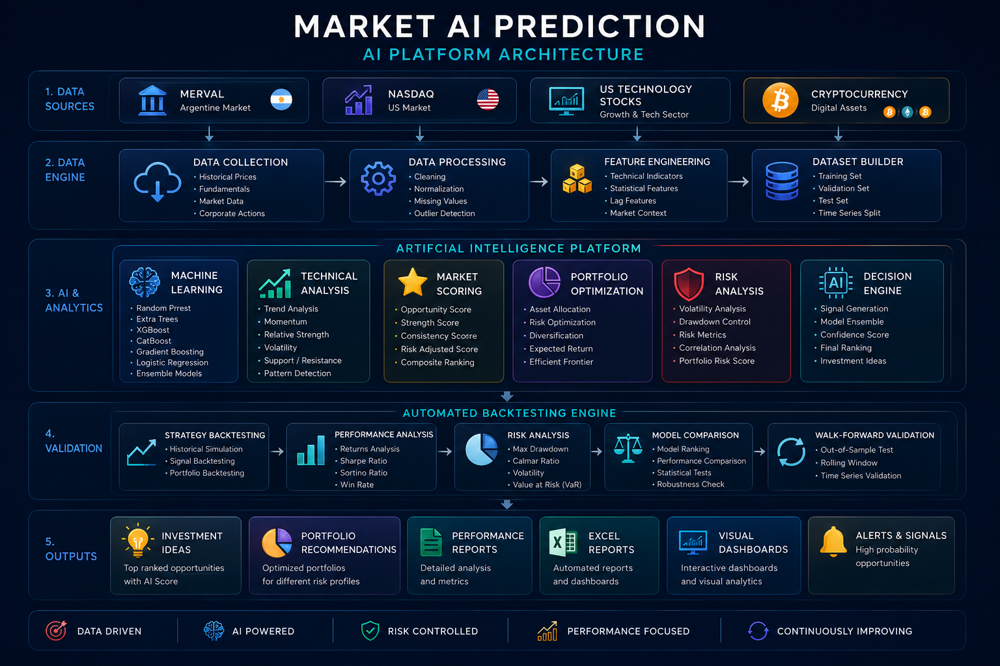

# Market AI Prediction - Platform Architecture

## Overview

Market AI Prediction has been designed as a modular Artificial Intelligence platform.

Each module performs a specific task while remaining independent from the others.

This architecture allows new AI models, markets and analysis engines to be integrated without modifying the existing pipeline.

## Architecture Diagram

<p align="center">

</p>

## Main Flow

```text
Financial Markets
↓
Historical Data
↓
Financial Dataset Engine
↓
Feature Engineering
↓
Artificial Intelligence Layer
↓
Portfolio Optimization
↓
Backtesting
↓
Reporting
↓
Decision Support
```

## Main Components

### Financial Dataset Engine

Responsible for historical data collection, cleaning, normalization and market datasets.

### Feature Engineering

Creates technical indicators, statistical features, market context and derived variables.

### Artificial Intelligence Layer

Includes Random Forest, Extra Trees, XGBoost, CatBoost, Gradient Boosting, Logistic Regression and Ensemble Learning.

### Market Scoring

Ranks assets using prediction confidence, technical strength, historical consistency and risk metrics.

### Portfolio Optimizer

Creates optimized portfolios considering risk, return, diversification and capital allocation.

### Automated Backtesting

Evaluates historical performance, strategy robustness, portfolio quality and predictive accuracy.

## Design Principles

- Modular
- Extensible
- Reusable
- Testable
- Data Driven
- AI First
