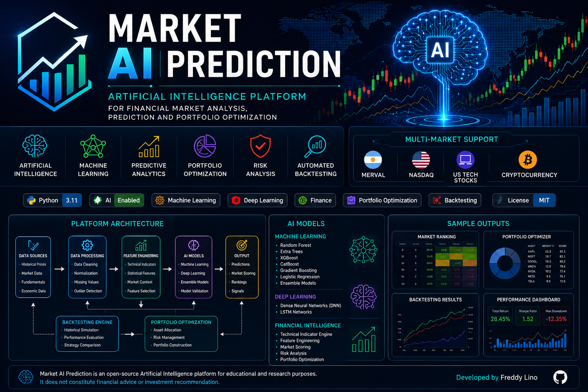

<p align="center">

</p>

<h1 align="center">Market AI Prediction</h1>

<h3 align="center">
Artificial Intelligence Platform for Financial Market Analysis, Prediction and Portfolio Optimization
</h3>

<p align="center">
An end-to-end Artificial Intelligence platform that combines Machine Learning, Quantitative Finance and Portfolio Optimization to support intelligent investment decisions across multiple financial markets.
</p>

---

<p align="center">


</p>

---

# Vision

Market AI Prediction is an Artificial Intelligence platform designed to analyze financial markets, evaluate investment opportunities and optimize portfolios using Machine Learning, quantitative analysis and automated backtesting.

Unlike traditional financial analysis tools, the platform combines multiple AI engines into a modular architecture capable of supporting different markets and future AI models.

---

# Platform Architecture

<p align="center">

</p>

---

# Project Highlights

- End-to-end Artificial Intelligence platform.
- Modular architecture designed for extensibility.
- Multi-market support: MERVAL, NASDAQ, US Stocks and Cryptocurrency.
- Machine Learning-based market scoring.
- Automated portfolio optimization.
- Historical backtesting framework.
- Financial feature engineering.
- Decision support through AI-generated rankings.
- Research-oriented architecture ready for future AI models.

---

# Artificial Intelligence

The platform combines several Artificial Intelligence technologies working together.

## Machine Learning Models

- Random Forest
- Extra Trees
- XGBoost
- CatBoost
- Gradient Boosting
- Logistic Regression
- Ensemble Learning

## Financial Intelligence

- Technical Indicator Engine
- Feature Engineering
- Market Scoring Engine
- Portfolio Optimization Engine
- Risk Analysis Engine
- Quantitative Analysis

## Validation Framework

- Automated Backtesting
- Walk Forward Validation
- Historical Validation
- Cross Validation
- Strategy Benchmarking

---

# Main Modules

| Engine | Description |
|---------|-------------|
| Financial Dataset Engine | Market data acquisition |
| Feature Engineering Engine | Automatic feature generation |
| Technical Indicator Engine | Technical analysis |
| Machine Learning Engine | Predictive modelling |
| Market Scoring Engine | AI opportunity ranking |
| Portfolio Optimization Engine | Capital allocation |
| Risk Analysis Engine | Portfolio risk evaluation |
| Backtesting Engine | Historical validation |
| Dashboard Engine | Reporting and visualization |

---

# Main Features

## Artificial Intelligence

- Machine Learning
- Ensemble Models
- Market Scoring
- Predictive Analytics
- Opportunity Ranking

## Financial Analysis

- Historical Prices
- Technical Indicators
- Trend Detection
- Momentum Analysis
- Volatility Analysis
- Relative Strength

## Portfolio Optimization

- Capital Allocation
- Portfolio Construction
- Risk Balancing
- Opportunity Ranking

## Automated Validation

- Historical Backtesting
- Performance Analysis
- Model Comparison
- Strategy Evaluation

---

# Supported Markets

- 🇦🇷 MERVAL
- 🇺🇸 NASDAQ
- 💻 US Technology Stocks
- ₿ Cryptocurrency

---

# Technologies

## Artificial Intelligence

- Python
- Scikit-Learn
- XGBoost
- CatBoost

## Data Engineering

- Pandas
- NumPy
- OpenPyXL

## Financial Analysis

- Yahoo Finance
- Technical Indicators
- Portfolio Optimization

## Visualization

- Matplotlib

---

# Current Capabilities

| Capability | Status |
|------------|:------:|
| Multi-Market Support | ✅ |
| Machine Learning Models | ✅ |
| Portfolio Optimization | ✅ |
| Automated Backtesting | ✅ |
| Market Ranking | ✅ |
| Feature Engineering | ✅ |
| Financial Indicators | ✅ |
| Excel Reporting | ✅ |
| AI Dashboard | ✅ |
| Modular Architecture | ✅ |

---

# Project Structure

```text
Market-AI-Prediction/
│
├── README.md
├── LICENSE
├── CONTRIBUTING.md
├── CHANGELOG.md
├── CODE_OF_CONDUCT.md
├── PROJECT_ARCHITECTURE.md
├── requirements.txt
├── .gitignore
│
├── docs/
│   ├── images/
│   │   ├── market_ai_banner.png
│   │   ├── architecture.png
│   │   ├── dashboard.png
│   │   ├── portfolio_optimizer.png
│   │   ├── backtesting.png
│   │   ├── ai_ranking.png
│   │   └── pipeline.png
│   │
│   └── diagrams/
│
├── source/
├── ai_lab/
├── datos/
├── modelos/
├── resultados/
└── notebooks/
```

---

# Design Principles

The platform has been developed following these principles:

- AI First
- Modular Design
- Data-Driven Decisions
- Explainability
- Reproducibility
- Extensibility
- Automation
- Continuous Validation

---

# Roadmap

## Completed

- Financial Dataset Engine
- Machine Learning Pipeline
- Portfolio Optimizer
- AI Market Ranking
- Automated Backtesting
- MERVAL
- NASDAQ
- Cryptocurrency

## Next Generation

- Meta AI Engine
- Explainable AI
- AutoML
- Ensemble Intelligence
- Sentiment Analysis
- AI Investment Assistant

---

# SQLite Cache Template

The repository includes a versioned, data-free SQLite schema template so cache databases can be recreated anytime without committing heavy data files.

- Schema template: `docs/sql/market_cache_schema.sql`
- Initialization script: `source/init_sqlite_cache.py`

Example usage:

```bash
py source/init_sqlite_cache.py crypto
```

This creates or updates the schema at:

`datos/<market>/cache/<market>_cache.sqlite`

You can also target a custom path:

```bash
py source/init_sqlite_cache.py crypto --db-path H:/tmp/crypto_cache.sqlite
```

---

# Optimizer Simulator

To run optimizer simulations without inline Python (`python -c ...`), use the dedicated runner script.

## 1) Default run from app_config

This uses values from `app_config.json`, including:

- `optimizer_simulator.target_days_list`
- `optimizer_simulator.target_min_returns`
- `optimizer_simulator.stop_loss_pct_list`

PowerShell (from project root):

```powershell
.\.venv\Scripts\python.exe .\run_optimizer_simulator.py --markets crypto
```

## 2) Override values from command line

```powershell
.\.venv\Scripts\python.exe .\run_optimizer_simulator.py `
	--markets crypto `
	--target-days 5,10,15 `
	--target-min-returns 0.015,0.03,0.05 `
	--stop-loss-pcts 0.015,0.02,0.03 `
	--start-date 2026-01-01 `
	--end-date 2026-08-15 `
	--liquidation-date 2026-08-15 `
	--initial-capital 1000 `
	--max-positions 5 `
	--top-models 3
```

## 3) Faster reruns without retraining

If datasets/models are already generated and you want faster scenario sweeps:

```powershell
.\.venv\Scripts\python.exe .\run_optimizer_simulator.py --markets crypto --skip-pipeline
```

Outputs are written under:

- `reportes/simulaciones_optimizer/simulacion_resumen_global.csv`
- `reportes/simulaciones_optimizer/<market>/sim_*.csv`

---

# Disclaimer

This software has been developed exclusively for educational and research purposes.

It should not be considered financial advice.

---

# Author

**Freddy Lino**

Artificial Intelligence • Machine Learning • Quantitative Finance • Python Development • Financial Analytics

---

# Project Vision

The objective of Market AI Prediction is to evolve into a complete Artificial Intelligence platform capable of integrating predictive models, quantitative finance techniques and portfolio optimization into a unified intelligent decision-support system.

⭐ If you find this project interesting, feel free to star the repository.
